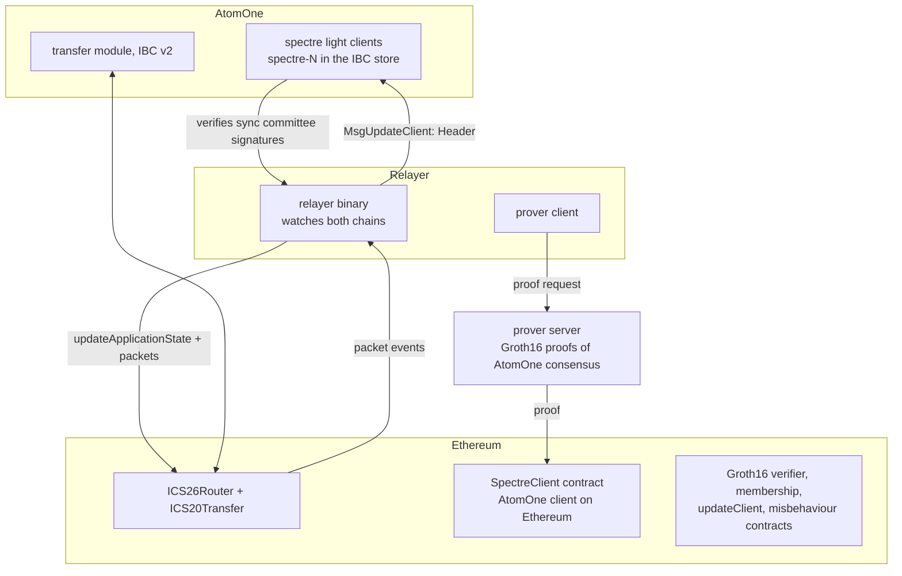
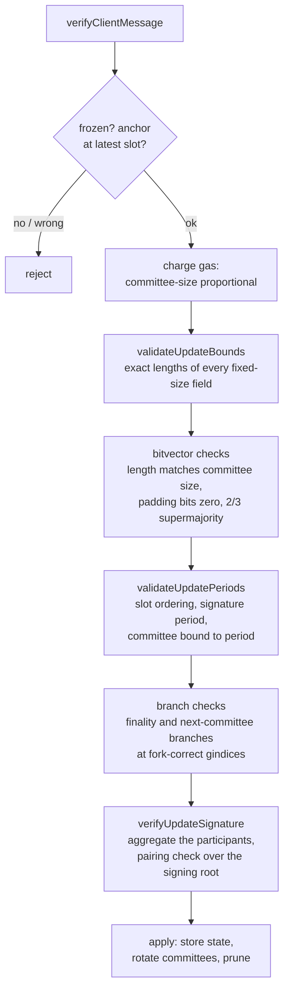

# The spectre Ethereum light client

Spectre is AtomOne's native Go implementation of an Ethereum light client, registered as an IBC light client module. It lets AtomOne verify Ethereum state without an Ethereum node: packet commitments, acknowledgements, and receipts held by the IBC router contract on Ethereum are proven against a small piece of trusted state that advances through BLS signatures. The Go module is a port of the Rust client in [trustless-protocol/spectre](https://github.com/trustless-protocol/spectre); the original lives in `packages/ethereum/light-client` there.

This document explains the trust model, the module's pieces, and the guarantees each check provides. Operational instructions are separate: `devnet-runbook.en.md` and `sepolia-runbook.en.md` in the repository root.

## The bridge at a glance

The bridge is two light clients facing each other. AtomOne tracks Ethereum with this module. Ethereum tracks AtomOne with a `SpectreClient` solidity contract, updated with Groth16 proofs that a prover server generates over AtomOne consensus. A relayer (from the spectre repository) moves packets both ways; everything it submits is verified, never trusted.

Money flows are escrow-and-mint in both directions. ETH → AtomOne locks tokens in the router's escrow and mints an `ibc/<hash>` voucher on AtomOne. AtomOne → ETH escrows `uatone` and mints a wrapped ERC20 on Ethereum.

## The trust model: sync committees

Ethereum's beacon chain rotates a sync committee of 512 validators every 256 epochs (8192 slots, about 27.3 hours on mainnet and Sepolia). During its period, the committee's validators sign beacon block headers; the light client accepts an update only when at least two thirds of the committee's bits are set, which is the threshold the protocol guarantees makes a signature unforgeable by any adversary holding under a third of the keys. The beacon state always carries both the current committee and the next one, committed one period ahead.

The light client only ever stores those two committees, as summaries: a hash of the 512 public keys and the aggregate public key. Full keys arrive with each message and must hash-match the stored summary. The chain of trust is short:

1. Bootstrap: client creation stores the current and next committee summaries for a finalized slot, taken from the beacon API at creation time.
2. Each update is signed by one of the two stored committees and proves, with a merkle branch against a signed beacon state root, whatever the client should learn next: a finalized header, and when crossing a period boundary, the committee after next.
3. The newly proven committee becomes stored state, and the chain repeats. Trust never extends past one committee rotation per verified update.

Which committee may sign is fixed by the signature's period: a signature in the client's stored period must come from the current committee, a signature in the next period from the next committee. The `is_next_committee` flag on the message must agree; a mismatch is rejected. This binding is what keeps a retired committee from signing one period past its tenure and installing a chosen committee (finding TMNSC-348, fixed in `6e361e99`).

## Messages the module accepts

| Type              | Carries                                                                                                                              | Effect                                                                                                          |
| ----------------- | ------------------------------------------------------------------------------------------------------------------------------------ | --------------------------------------------------------------------------------------------------------------- |
| `Header`          | attested beacon header, finalized header, optional next committee with branch, sync aggregate (bits + BLS signature), signature slot | Advances the client: stores a new consensus state, rotates committees on period change, prunes below the window |
| `Misbehaviour`    | two updates for the same attested slot with different execution commitments                                                          | Freezes the client permanently                                                                                  |
| `MembershipProof` | Ethereum account proof + storage proof                                                                                               | Answers `VerifyMembership` / `VerifyNonMembership` for packet data, against a stored execution state root       |

Both `Header` and `Misbehaviour` travel inside a permissionless `MsgUpdateClient`. `Misbehaviour` freezes rather than crashes because two conflicting commitments both verifying means the committee equivocated, and nothing it signed can be trusted afterwards.

## The verification pipeline

`verifyClientMessage` (in `client_state.go`) is the single entry point. It rejects frozen clients, resolves the anchor consensus state, charges gas, and dispatches. Header verification runs, in order:

Each stage exists because something concrete went wrong without it:

- **Exact field lengths** (`validateUpdateBounds`): the SSZ hashing helpers pad and truncate to 32 bytes, so a field one byte longer than its spec length hashed like the honest value. That let a header store an unprovable consensus state, and let a single honest signature pass as "conflicting" misbehaviour and freeze the client. Every fixed-size field of both headers is length-checked before any hashing.
- **Bitvector semantics**: the sync bits are a bitvector over exactly `SyncCommitteeSize` members. Set padding bits are rejected, and the 2/3 supermajority counts real members only, so padding cannot inflate a small committee's participation.
- **Committee binding**: covered above. Misbehaviour additionally requires both updates to be signed in the client's current period or later, so the keys of a committee the client has already left cannot freeze it.
- **Gas** (`gas.go`): a full verification is up to 512 BLS public key parses, an aggregation, a hash-to-G2, and a pairing. The message's size-based gas pays for none of that, so the cost is charged upfront, before any BLS work: one committee pass for a header, two for a misbehaviour, at `GasCostBlsPass` plus `GasCostPerPubkey` per key. At 512 keys a header costs about 2.7 M gas, which bounds how much unmetered CPU a block of update spam can buy.

Fork handling runs through the pipeline rather than around it. The client state carries the full fork schedule from genesis to Gloas. Beacon state and block body fields move at fork boundaries, so the merkle gindices for the finalized root and next committee switch at the Gloas epoch, and the execution commitment changes shape: pre-Gloas headers carry the full execution payload header; Gloas headers carry only `execution_block_hash`, with the stored state root, timestamp, and block number recovered from an RLP-encoded execution header whose keccak hash must equal the proven block hash.

Membership verification (`membership.go`) is pure Ethereum merkle-patricia-trie work: an account proof from the execution state root to the router contract's storage root, then a storage proof for the commitment key, which is `keccak256(keccak256(path) || ibcCommitmentSlot)`. Non-membership proves the zero value. Proof heights must fall inside `[latest - 7 days, latest]`: the same window pruning keeps, so whether pruning has run never decides whether a proof verifies.

## State model

The module has no store of its own. Everything lives in the IBC store, under client-prefixed sub-stores the 02-client keeper hands out, managed with SDK collections:

- `clients/spectre-N/clientState`: one `collections.Item`, the full `ClientState` (chain id, genesis slot and validators root, slot and committee constants, fork schedule, IBC contract address and commitment slot, latest slot, frozen flag).
- `clients/spectre-N/consensusStates/0-<slot>`: one entry per finalized slot the client holds, as a `collections.Map` keyed by the height string: the execution state root, timestamp, and the two committee summaries.

Keys and values are byte-identical to what ibc-go core iterates when it lists clients and consensus states (`GetAllClientStates`, `GetAllConsensusStates`), which is a compatibility contract, not a coincidence: `store.go` builds the collections over the client-prefixed store, and `TestStoreLayoutMatchesCoreIBC` locks the layout.

Consensus states accumulate one per finality advance and are pruned on every applied update, inside the relayer's metered transaction (skipped in CheckTx, like the 07-tendermint client). Only states within the 7-day window survive, the latest is always kept, and a client that stops updating stops growing, so no per-block sweeper exists.

Because the state sits in the IBC store, the module needs no store key, no genesis entry, and no consensus version. It is wired in `app/keepers/keepers.go` as a route on the client keeper plus an `AppModule` that registers protobuf interfaces; the v5 upgrade handler adds `spectre` to the `AllowedClients` param. Client state and consensus states ride in the IBC genesis export like any other light client's.

## Freeze and recovery

Freezing is terminal for the client's own logic: a frozen client rejects updates and proofs. Because `RecoverClient` is implemented, it is not terminal for the bridge. Governance submits `MsgRecoverClient` (gov-authority only in ibc-go) naming the frozen subject and a fresh, active substitute. `recovery.go` checks the substitute tracks the same chain and bridge (every parameter must match; only progress fields may differ), deletes the subject's consensus states, which may come from the equivocating committee's branch, and copies the substitute's in their place. The client resumes under its own identifier. This replaces the old remedy of a coordinated software upgrade with a repair migration.

## What the module does not do

- It never reports `Expired`. A stale client stays Active and relayers can catch it up one committee period per update, using historical signatures, however far behind it is.
- It does not support non-zero IBC delay periods on proofs; the 7-day window is the only timeliness rule, and it is a constant in code (`PruneKeepDuration`), sized above any sane packet timeout, not a governance parameter.
- Recovery is a governance trust decision, not a cryptographic one. When it runs, the chain chooses to believe the substitute over the frozen client's evidence.

## Where things live

| File                                  | Contents                                                                                              |
| ------------------------------------- | ----------------------------------------------------------------------------------------------------- |
| `client_state.go`                     | client state type, `verifyClientMessage` dispatch, update application, membership entry points        |
| `client_state_logic.go`               | the verification pipeline: bounds, bitvector, periods, committee binding, branches, BLS, misbehaviour |
| `ssz.go`, `merkle.go`                 | SSZ hash-tree-roots, generalized-index merkle branch validation                                       |
| `execution.go`                        | Gloas execution headers: RLP parsing, keccak hash check                                               |
| `bls.go`                              | BLS12-381 public key and signature parsing, aggregate verification                                    |
| `membership.go`, `trie.go`            | Ethereum MPT proofs for packet commitments                                                            |
| `store.go`                            | collections over the client store: codecs, layout contract                                            |
| `gas.go`                              | verification gas costs                                                                                |
| `pruning.go`                          | window computation, the pruning scan                                                                  |
| `recovery.go`                         | governance client recovery                                                                            |
| `light_client_module.go`, `module.go` | the ibc-go `LightClientModule` interface and the app module                                           |
| `migrations/`                         | an optional pruning helper for in-place store migrations                                              |

The upstream reference for every verification rule is `trustless-protocol/spectre`, `packages/ethereum/light-client`. Gas metering, the pruning window, governance recovery, and the store layout are AtomOne additions on top of that port, and this document is the record of them.
